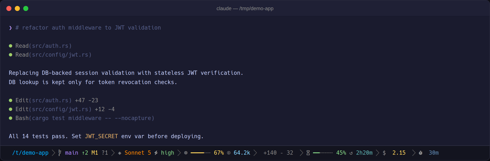
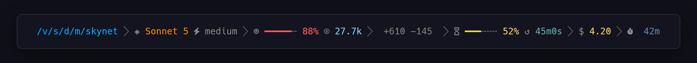
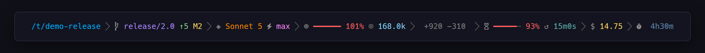
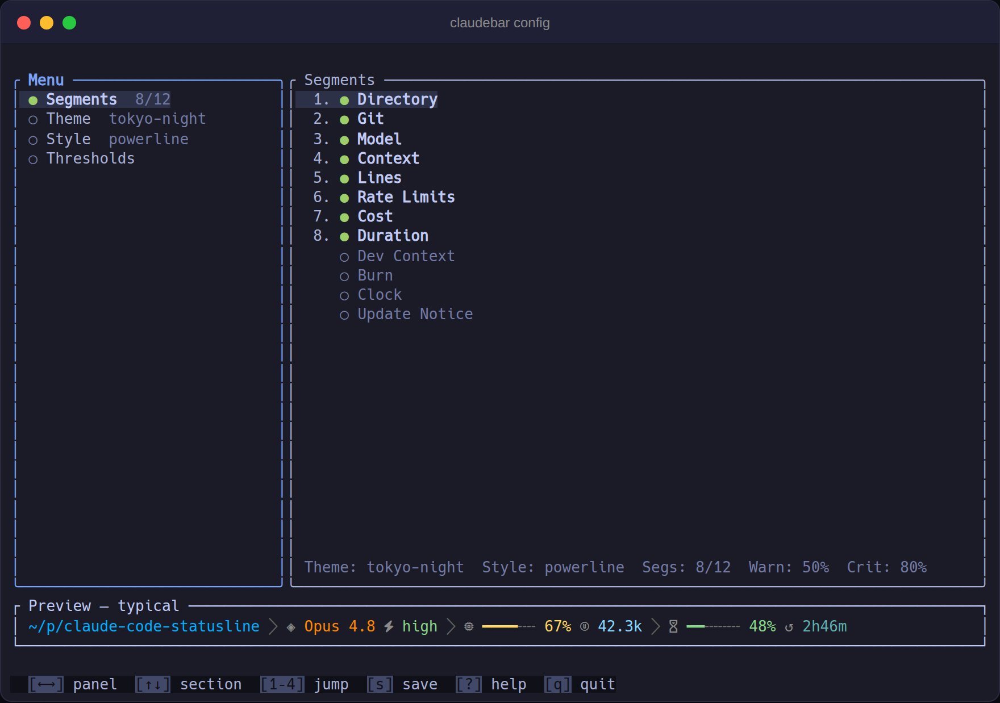

<div align="center">


Keep an eye on context usage, rate limits, Git status, and cost while you work in Claude Code.

[![CI][ci-badge]][ci-url] [![Release][release-badge]][release-url] [![Provenance][provenance-badge]][verification-url] [![MIT license][license-badge]][license-url]

[Install](#install) · [Configure](#configure) · [Demo & theme gallery](https://micschr0.github.io/claudebar/)

</div>



## Install

claudebar runs on macOS and Linux, on Intel/AMD64 and ARM64.
Prebuilt binaries need no Rust toolchain.

Powerline icons need a [Nerd Font](https://www.nerdfonts.com/).
Without one, select `ascii` in the configurator.

### Install script

Requires Bash, curl, and jq. Git is needed for the Git segment.

> [!IMPORTANT]
> The script installs claudebar and configures Claude Code automatically,
> replacing any existing `statusLine` setting.
> Package-manager installations use an interactive setup instead.

```bash
curl -fsSL https://raw.githubusercontent.com/micschr0/claudebar/main/install.sh | bash
```

Restart Claude Code. The statusline appears on the next turn.

You can check the installation without starting Claude Code:

```bash
~/.claude/claudebar smoke
```

[Review the script](install.sh) before running it.

### Package managers

Choose one:

| Package manager | Install |
|---|---|
| Homebrew | `brew install micschr0/tap/claudebar` |
| mise | `mise use -g github:micschr0/claudebar` |
| pnpm | `pnpm add -g @micschr0/claudebar` |

Then configure Claude Code:

```bash
claudebar setup
```

Setup shows a diff, asks before writing, and backs up the previous
settings file. Restart Claude Code afterward.

### Release verification

SHA256 checksums detect changed downloads. Build provenance identifies
the workflow that built the binary.

| Method | Verification |
|---|---|
| Script | Checks SHA256; also checks provenance when `gh` is installed and authenticated |
| mise | Checks SHA256 and provenance automatically |
| Homebrew | Checks SHA256, without build provenance |
| npm/pnpm | Ship the release binaries; installation does not verify their GitHub build provenance |

The script stops on a checksum mismatch. A provenance failure produces
a warning.

[Manual release verification](SECURITY.md#verifying-a-release)

## Session information

claudebar can show:

- Context-window usage with token counts and color-coded bars.
- 5-hour and 7-day rate-limit usage with reset countdowns, when
  Claude Code supplies the data.
- Working directory, Git branch, working-tree status, active model,
  and reasoning effort.
- Session cost, elapsed time, and lines changed.

There are 11 selectable segments, 16 themes, and 8 styles. You can
toggle and reorder segments in the configurator. Segments without
usable data stay hidden.

claudebar uses Claude Code's status line and leaves your shell prompt
unchanged.

### Usage colors

The default warning thresholds are 50% and 80%.
Both are configurable.

High usage:



Over limit:



## Configure

```bash
claudebar config
```

The configurator previews changes as you select themes and styles,
reorder segments, or adjust thresholds. Press `?` for help, `s` to save,
and `q` to quit.



Eight segments are enabled by default. Development context, burn, and
clock are optional.

[Theme and style gallery](https://micschr0.github.io/claudebar/#gallery-grid)

### Edit the config file

```bash
claudebar edit
```

The config file is at `$XDG_CONFIG_HOME/claudebar/config.toml`,
or `~/.config/claudebar/config.toml` when XDG_CONFIG_HOME is unset.

```toml
theme = "tokyo-night"
style = "powerline"
segments = ["directory", "git", "model", "context", "lines", "rate-limits", "cost", "duration"]

[thresholds]
warn = 50
crit = 80
```

`claudebar edit` uses `$EDITOR`, then `$VISUAL`, then `vi`.
Editor arguments are supported: `EDITOR='code --wait' claudebar edit`.

The configurator refuses malformed or unreadable config files.
It saves atomically and keeps your edits open if saving fails.

## Commands

| Command | Purpose |
|---|---|
| `claudebar smoke` | Render a built-in sample |
| `claudebar doctor` | Diagnose font, Git, config, and PATH issues |
| `claudebar list` | List themes and styles |
| `claudebar list --list-segments` | List selectable segments |
| `claudebar sync` | Add newly introduced segments to your config |
| `claudebar setup --print` | Preview Claude Code settings without writing |
| `claudebar render` | Read session JSON from stdin and write the statusline |

Run `claudebar --help` for more commands and flags.

If icons appear as boxes or broken characters, select `ascii` in the
configurator. If your shell cannot find `claudebar` after a script
install, use `~/.claude/claudebar` and check your PATH.

## Updates

A background process checks for new releases at most once a day.
When a newer stable version is available, claudebar shows an update
notice. Rendering reads a local cache and never waits for the network.

Check immediately with:

```bash
claudebar update
```

Updates are not installed automatically. Use your original installation
method to upgrade.

For scripts, `claudebar update --check` returns `0` on a successful
check even when an update is available. Without `--check`, an available
update returns `2`. A failed check returns `1`.

### Beta channel

Beta releases may be unstable. Stable installations stay on stable
unless you select beta.

| Method | Install beta |
|---|---|
| Homebrew | `brew install micschr0/tap/claudebar-beta` |
| pnpm | `pnpm add -g @micschr0/claudebar@beta` |

With the script:

```bash
curl -fsSL https://raw.githubusercontent.com/micschr0/claudebar/main/install.sh | CLAUDEBAR_CHANNEL=beta bash
```

To install a specific release, set `CLAUDEBAR_VERSION` on the bash side
of the pipe, without the leading `v`:

```bash
curl -fsSL https://raw.githubusercontent.com/micschr0/claudebar/main/install.sh | CLAUDEBAR_VERSION=2026.7.6-beta.1 bash
```

To return to stable with Homebrew, uninstall `claudebar-beta` and
install `micschr0/tap/claudebar`. For npm/pnpm, use `@latest`.

Check for beta updates with `claudebar update --channel beta`.

## Uninstall

Use the method you installed with:

```bash
brew uninstall claudebar
# or: pnpm remove -g @micschr0/claudebar
# or, for the script install: rm ~/.claude/claudebar
```

For a script install, also remove the command symlink created by the
installer. For the Homebrew beta, uninstall `claudebar-beta`.

Remove the `statusLine` entry from `~/.claude/settings.json`.
You can keep the claudebar config for a later installation or remove
its configuration directory.

[Demo & gallery](https://micschr0.github.io/claudebar/) ·
[Contributing](CONTRIBUTING.md) ·
[Create a theme](CONTRIBUTING-themes.md) ·
[Internals](openwiki/index.md) ·
[Changelog](CHANGELOG.md) ·
[Report an issue](https://github.com/micschr0/claudebar/issues) ·
[MIT license](LICENSE)

[ci-badge]: https://img.shields.io/github/actions/workflow/status/micschr0/claudebar/rust.yml?style=flat-square&label=CI
[ci-url]: https://github.com/micschr0/claudebar/actions/workflows/rust.yml
[release-badge]: https://img.shields.io/github/v/release/micschr0/claudebar?style=flat-square&label=release
[release-url]: https://github.com/micschr0/claudebar/releases/latest
[provenance-badge]: https://img.shields.io/badge/provenance-attested-2ea44f?style=flat-square
[verification-url]: SECURITY.md#verifying-a-release
[license-badge]: https://img.shields.io/badge/License-MIT-blue?style=flat-square
[license-url]: LICENSE
